# 账税通页面功能与业务价值说明

> 版本：V1 受控试点界面基线  
> 编制日期：2026-10-11  
> 截图规格：1920 × 1080 PNG

## 1. 文档用途

本文档逐页说明「账税通」宣传官网和业务平台的页面目标、主要功能、使用者、上下游关系与业务价值。它可用于：

- 向产品、设计、研发、测试与专业财税人员统一页面语义。
- 在其他电脑或 AI 环境中继续研发时，快速理解已有界面的职责边界。
- 作为后续视觉回归、验收测试和演示素材的基线。
- 评估某个功能应由用户、专业复核人员还是平台运营人员操作。

## 2. 整体产品链路

V1 的主线不是「自动代替用户报税」，而是把真实业务逐步转化为可核对、可追溯、可复核的申报准备材料：

1. **身份与企业准入**：登录/注册 → 建立企业档案 → 适用性筛查。
2. **账套初始化**：设置资金账户、期初余额、会计期间和往来单位。
3. **业务事实归集**：录入业务事件，导入银行流水，管理发票与原始单据。
4. **账务处理**：生成凭证草稿 → 人工确认 → 账簿/报表 → 勾稽检查。
5. **风险复核**：勾稽差异、反结账等高风险事项进入人工复核中心。
6. **申报准备与归档**：征期待办 → 试算准备 → 冻结申报包 → 用户自主申报 → 回执/凭证归档 → 关闭。
7. **规则与权限治理**：政策来源、规则版本、黄金样本、成员权限和运营角色独立治理。

---

## 3. 官网与入口页

### 00. 宣传官网首页

- **页面定位**：独立的对外宣传和产品认知页，不是业务平台的一部分。
- **主要内容**：介绍产品定位、四步工作流程、证据链、勾稽检查、申报待办与红黄绿风险分流。
- **核心行动**：访客点击「进入平台」后，才跳转至业务平台登录页。跳转地址由官网 `config.js` 单独配置。
- **主要用户**：潜在客户、合作机构、投资人、渠道伙伴和首次了解产品的访客。
- **作用价值**：在用户接触复杂界面前先说清「产品解决什么、如何控制风险、什么不会自动做」，降低认知成本并建立信任。
- **独立性**：官网使用原生 HTML/CSS/JS，不引用平台组件、数据库、Cookie 或会话，可单独仓库和域名部署。

### 01. 平台根入口

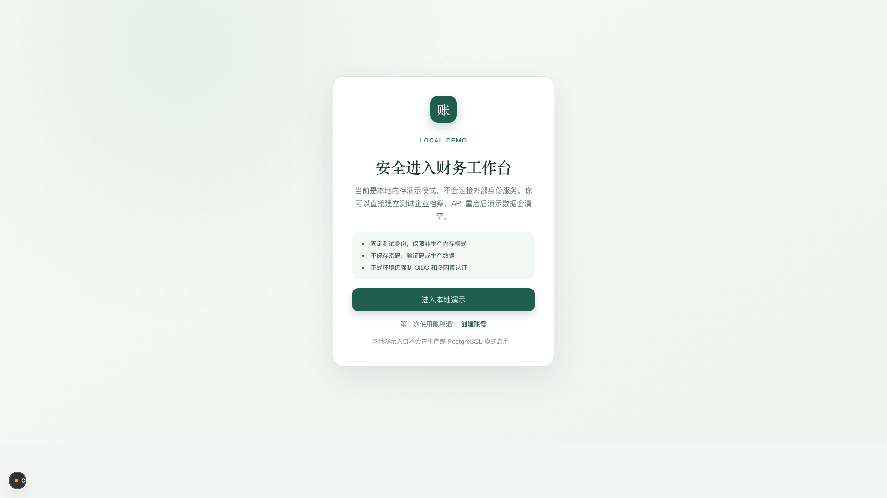

- **页面定位**：业务平台根路由 `/`，本身不承载业务表单。
- **路由逻辑**：有有效会话时进入账套工作台；没有会话时进入登录页。截图展示未登录的本地演示状态。
- **主要用户**：所有直接访问平台域名的用户。
- **作用价值**：作为统一入口及时完成身份分流，避免未登录用户看到业务页，也避免已登录用户重复操作。
- **安全意义**：正式 OIDC 模式下，是访问控制链路的第一层，与 HttpOnly 会话 Cookie 配合使用。

### 02. 安全登录

- **页面定位**：已有用户的身份认证起点。
- **主要功能**：生产模式下发起 OIDC Authorization Code + PKCE 登录；本地内存演示模式下使用固定测试身份进入。
- **页面提示**：明确说明密码、短信验证码、OTP 种子和 WebAuthn 私钥不进入业务数据库。
- **主要用户**：企业所有者、成员、专业复核人员和平台运营人员。
- **作用价值**：将身份安全与财税业务逻辑分离，避免自建密码体系造成不必要的安全风险。

### 03. 创建账号

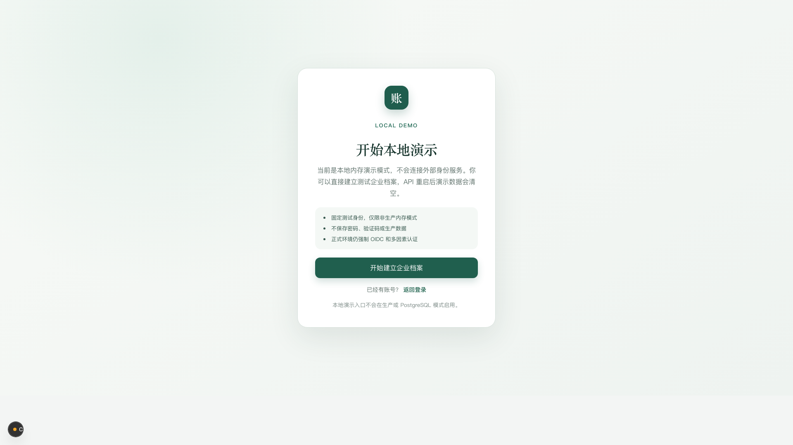

- **页面定位**：新用户创建个人身份并开始首个企业建档的入口。
- **主要功能**：生产模式跳转企业身份服务完成账号创建与验证；本地模式直接开始演示建档。
- **关键规则**：个人身份与企业档案分离；首位用户建立企业并成为所有者；后续成员通过受控邀请加入。
- **主要用户**：首次使用平台的公司负责人。
- **作用价值**：在系统建立清晰的「人—租户—企业—角色」关系，为多企业和成员权限隔离奠定基础。

### 04. OIDC 登录回调

- **页面定位**：身份 Provider 认证完成后返回平台的技术回调页，不是用户日常工作页。
- **主要功能**：验证 `code` 和 `state`，调用后端换取身份结果，建立平台安全会话，再跳转到原目标页。
- **异常处理**：缺少参数、状态不匹配、身份服务不可用时停留在可理解的错误状态，不进入业务平台。
- **主要用户**：系统自动调用，用户只会短暂看到「建立安全会话」状态。
- **作用价值**：完成外部身份与本地用户/会话的安全衔接，防止回调重放、开放重定向和会话冒用。

---

## 4. 企业建档与账套初始化

### 05. 账套初始化工作台

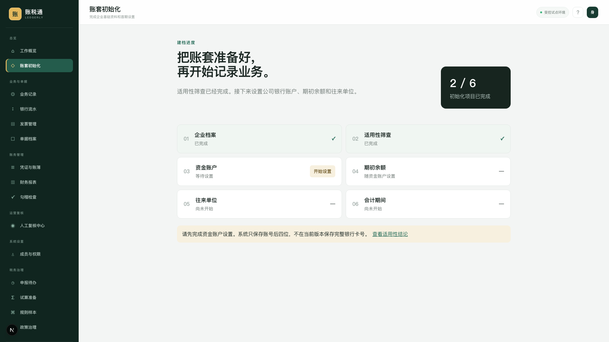

- **页面定位**：企业通过准入筛查后的初始化任务总览。
- **主要功能**：展示企业档案、适用性筛查、资金账户、期初余额、往来单位和会计期间六项完成状态。
- **交互规则**：按前置依赖引导用户设置；未完成必要项时不开放业务记录入口。
- **主要用户**：企业所有者、租户管理员或负责初始建账的人员。
- **作用价值**：把易漏的建账条件变成清晰清单，避免在账户、期间、期初余额未确定时直接开始记账。

### 06. 建立企业档案

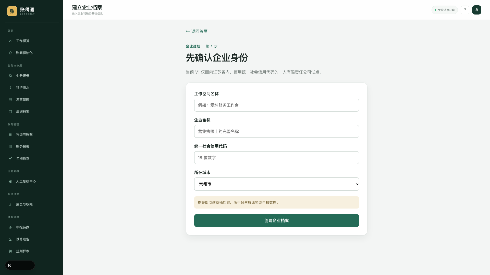

- **页面定位**：企业建档第一步，创建工作空间和企业主体草稿。
- **主要字段**：工作空间名称、企业全称、18 位统一社会信用代码和所在城市。
- **数据边界**：提交只创建企业草稿档案，尚不生成凭证、账簿、税额或申报数据。
- **主要用户**：首位企业用户/企业所有者。
- **作用价值**：建立所有后续数据的租户与企业归属，是数据隔离、权限判定和审计追溯的根节点。

### 07. 适用性筛查

- **页面定位**：企业建档第二步，判断当前主体能否进入 V1 自助流程。
- **主要功能**：收集主体类型、增值税纳税人身份、申报周期、企业所得税征收方式、主营行业和复杂业务风险问题。
- **输出结论**：绿色可进入初始化；黄色需要人工复核；红色超出自动化边界。不确定时鼓励先选中风险项。
- **主要用户**：企业负责人，必要时由专业财税人员协助。
- **作用价值**：优先识别「不应该自动做」的业务，防止用一套简化规则错误处理复杂主体。

### 08. 资金账户与首期设置

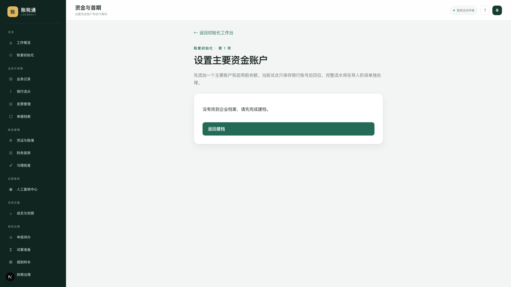

- **页面定位**：账套初始化第一项，建立主要资金账户和首个会计期间。
- **主要功能**：选择银行账户或现金，录入账户名称、银行、账号后四位、启用前余额、余额来源和首个会计月份。
- **系统处理**：根据真实来源生成平衡的期初分录，同时创建会计期间。非零余额必须选择来源。
- **安全边界**：当前试点只保存银行账号后四位，不保存完整卡号。
- **作用价值**：把账簿起点与真实资金余额对齐，避免后续对账从错误起点开始。

### 09. 往来单位管理

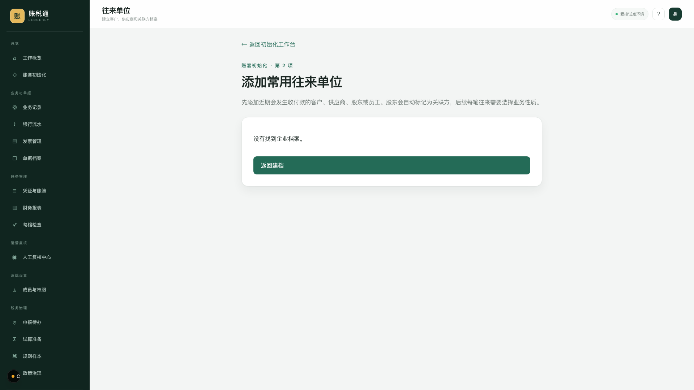

- **页面定位**：账套初始化第二项，维护客户、供应商、股东、员工及其他往来方。
- **主要功能**：录入类型、名称、统一社会信用代码、联系人、联系电话和备注；展示已建立的往来单位。
- **特殊规则**：股东自动标记为关联方，后续往来必须区分真实业务性质。
- **主要用户**：企业所有者、管理员或记账人员。
- **作用价值**：建立发票、流水、业务事件和往来核销的统一主体索引，减少同名、错配和关联方识别错误。

---

## 5. 业务事实与原始证据

### 10. 业务记录

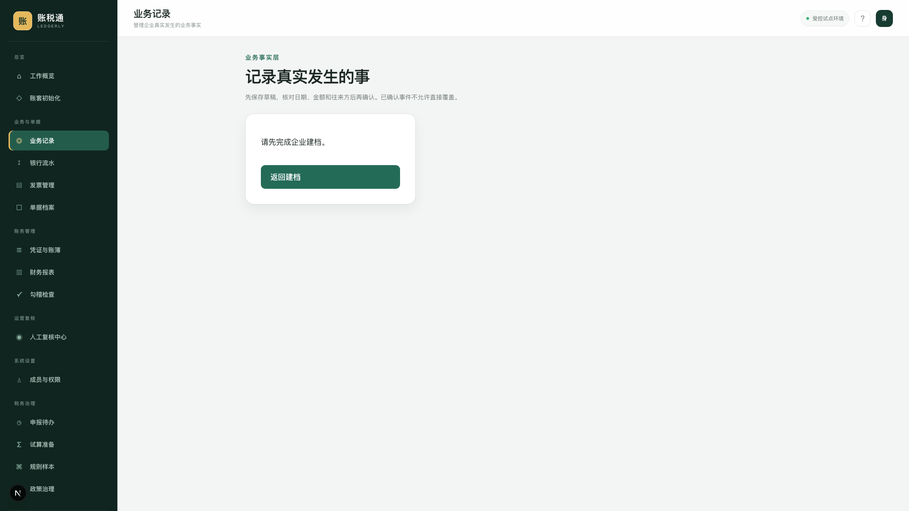

- **页面定位**：财税数据的「业务事实层」，先记录发生了什么，再生成会计表达。
- **主要功能**：选择业务类型、日期、金额、往来单位和事项说明；先保存草稿，再由人工确认。
- **数据规则**：只有已确认事件才能进入凭证生成；已确认事件不允许直接覆盖，修改应留下新版本或后续记录。
- **当前截图状态**：因尚未完成演示企业建档，页面提示返回建档。
- **作用价值**：将「真实发生的事」与「系统如何记账」解耦，便于规则更新、重新生成和追责。

### 11. 银行流水导入

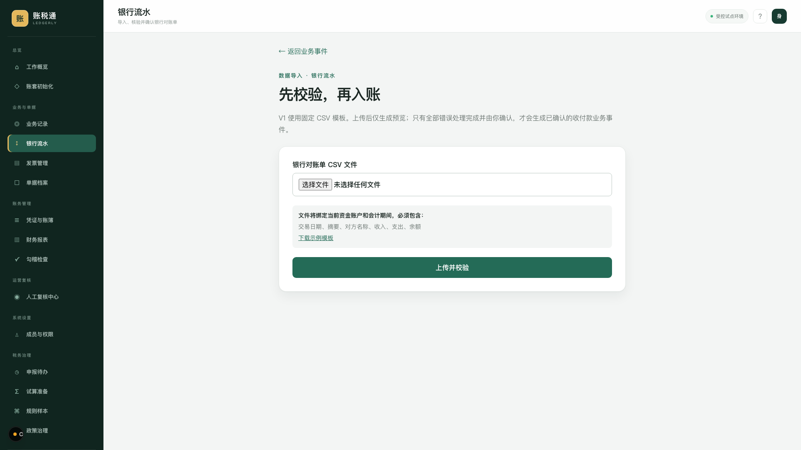

- **页面定位**：把银行对账单转换为可核对的收付款业务事件。
- **主要功能**：下载固定 CSV 模板，上传对账单，按行预览日期、对方、收支方向、金额、余额、重复与错误。
- **控制规则**：上传只生成预览；所有错误处理完成且用户确认后，才生成已确认收付款事件；重复行不重复导入。
- **主要用户**：企业所有者或记账人员。
- **作用价值**：减少手工逐笔录入，同时保留「先校验、后入账」的人工控制点。

### 12. 发票管理

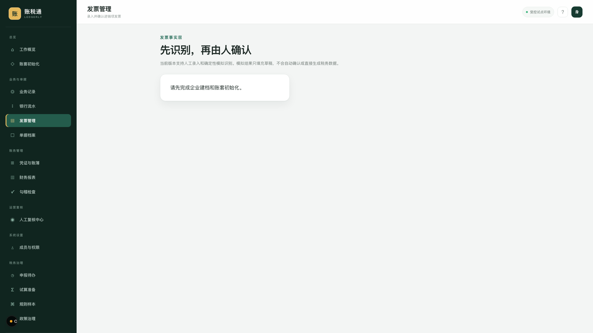

- **页面定位**：记录进项/销项发票事实，与银行收付和业务事件独立保存。
- **主要功能**：录入方向、普票/专票、蓝字/红字、开票日期、发票号码、往来单位、不含税金额、税额和价税合计。
- **识别能力**：当前提供确定性模拟 OCR，只把结构化结果填入草稿，不上传真实文件，也不自动确认。
- **控制规则**：校验发票号重复、往来单位类型和价税关系；红字发票由字段表达冲减方向，录入金额仍为正数。
- **作用价值**：把「机器识别」与「人工确认」分开，为税务计算保留可信的发票事实。

### 13. 单据档案

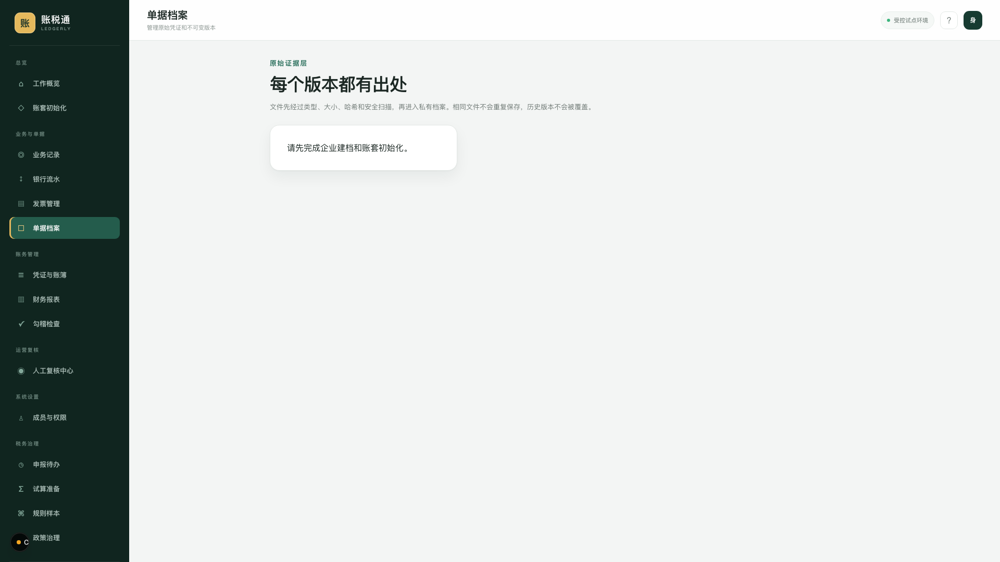

- **页面定位**：原始证据文件层，用于保存合同、发票附件、回单和其他原始凭证。
- **主要功能**：上传新单据、为已有档案追加新版本、查看版本与下载当前版本。
- **安全与完整性**：文件先经类型、大小、哈希和安全扫描；相同文件返回已有档案，不重复保存；新版本不覆盖旧版本。
- **主要用户**：企业成员、记账人员、复核人员和档案管理人员。
- **作用价值**：使凭证、报表、申报包能继续向下追溯到原始文件，支持审计、争议处理和长期档案导出。

---

## 6. 账务处理与风险复核

### 14. 凭证、账簿与期间管理

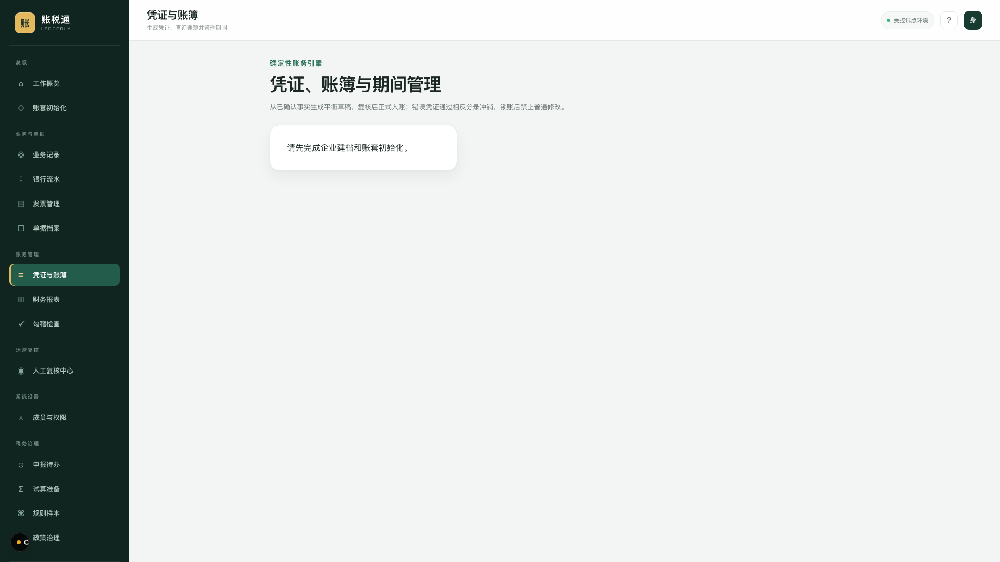

- **页面定位**：把已确认业务事实转换为确定性凭证、正式账簿和会计期间状态。
- **主要功能**：从业务事件生成借贷平衡草稿，人工确认入账，查看分录与账簿，通过相反分录冲销错误凭证。
- **期间控制**：所有草稿处理完成后可锁账；锁账后普通写入被阻止；反结账必须提交理由并由不同复核人决定。
- **阻断规则**：未完成核销、证据不足、事项不在开放期间或期间已锁定时，系统停止自动入账。
- **作用价值**：不删除、不覆盖正式记录，通过确认、冲销、锁账和反结账审批建立可审计的账务链路。

### 15. 财务报表

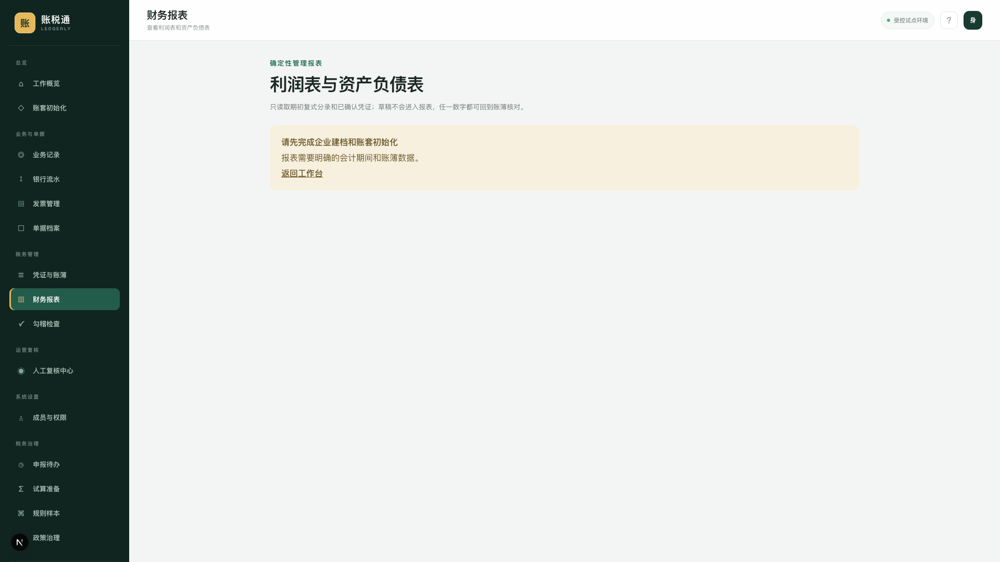

- **页面定位**：面向经营管理的确定性利润表和资产负债表。
- **数据来源**：只读取期初复式分录和已确认凭证，草稿不进入报表。
- **主要功能**：按明确会计期间生成报表，显示报表口径，支持从报表数字回到账簿核对。
- **当前边界**：V1 是最小科目模板的管理报表；正式对外报送前还需扩展法定行项映射并经专业复核。
- **作用价值**：让企业主理解财务结果，同时保持每一个数字的可追溯性。

### 16. 勾稽检查与往来核销

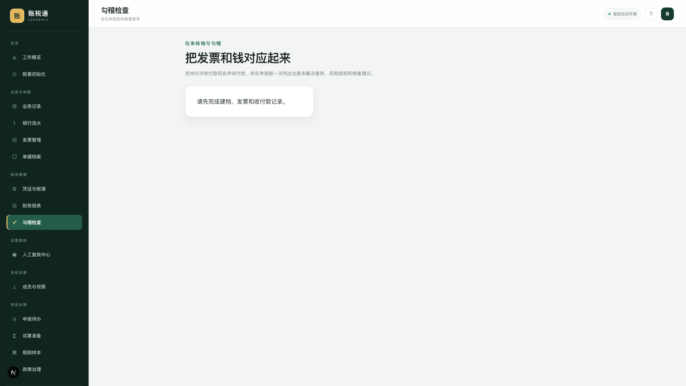

- **页面定位**：在申报准备前将发票、收付款、往来和账簿之间的差异集中显示。
- **主要功能**：创建发票与收付款的分次/合并核销，冻结当前输入并运行全部勾稽检查，显示期初、本期发生、期末、试算平衡和应收应付明细问题。
- **风险分流**：红色问题阻断后续申报，黄色问题需处理或复核；可把指定差异送入人工复核中心。
- **关键原则**：人工备注不会直接解除阻断，必须修正真实事实并重新运行检查。
- **作用价值**：在申报前暴露差异，并把「有问题」转化为「哪里有问题、严重程度、如何修复」。

### 17. 人工复核中心

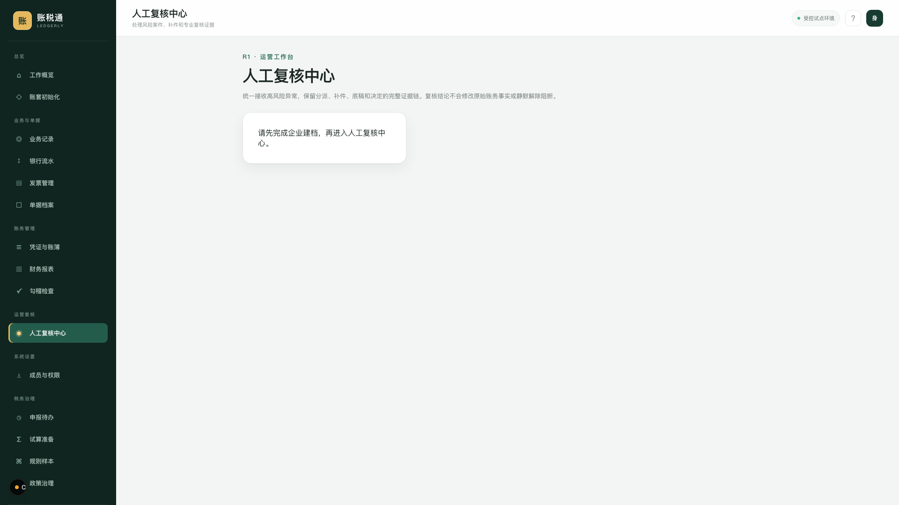

- **页面定位**：专业运营工作台，统一接收勾稽异常和反结账申请等需人工判断的案件。
- **主要功能**：筛选队列，独立复核人接单/转交，追加复核底稿，请求补件，恢复复核，最终批准或驳回。
- **证据链**：保留分派、补件、复核记录、决定、处理人和版本。
- **关键原则**：复核批准只记录专业结论，不静默修改原始账务事实，也不自动解除勾稽阻断。
- **作用价值**：将「系统不能安全决定」的事项有序转交给人，不用口头、微信或线下记录代替可审计流程。

---

## 7. 申报准备与规则质量

### 18. 申报待办、申报包、回执与调整

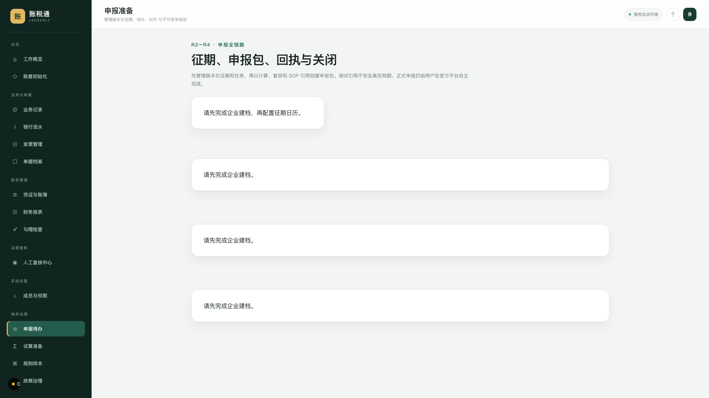

- **页面定位**：申报全链路工作区，覆盖征期任务、冻结申报包、回执/完税凭证、任务关闭、更正工单和档案导出。
- **征期与待办**：当前可建立明确标识的测试日历，幂等生成任务，记录用户已在官方渠道自主申报或缴款。
- **申报包**：引用任务、计算运行、已批准复核、SOP 和哈希快照；服务端冻结前重新校验所有引用，冻结后不覆盖。
- **回执与关闭**：归档用户从官方渠道取得的申报回执和完税凭证，校验结果哈希后生成不可变关闭记录。
- **调整与导出**：通过作废、更正、补税或退税工单追加后续处理，不修改原包/原回执；可导出带原始内容和逐文件 SHA-256 的可移植 JSON 年度档案。
- **当前边界与价值**：不代登录、不代申报、不发起扣款；价值是将申报前后的证据、决定和结果联成一条不可静默改写的链路。

### 19. 税务试算准备检查

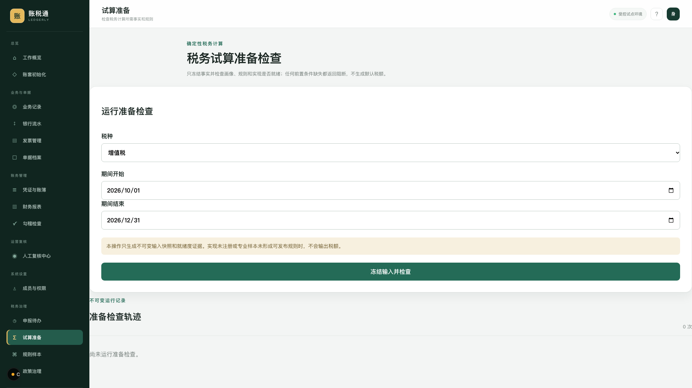

- **页面定位**：在任何税额计算前，先检查事实、企业画像、规则和可执行实现是否同时就绪。
- **主要功能**：选择期间/税种，冻结当前输入快照，运行准备检查，保存不可变运行记录。
- **阻断条件**：缺少适用性画像、主体不适用、无已确认事实、无匹配活动规则、匹配多条规则或计算实现未注册。
- **关键原则**：任一前置条件不成立就返回阻断，不用默认税率、试猜规则或生成看似完整的税额。
- **作用价值**：把「不能算」做成显式、可解释的结果，比输出一个错误但精确的数字更安全。

### 20. 黄金样本工作台

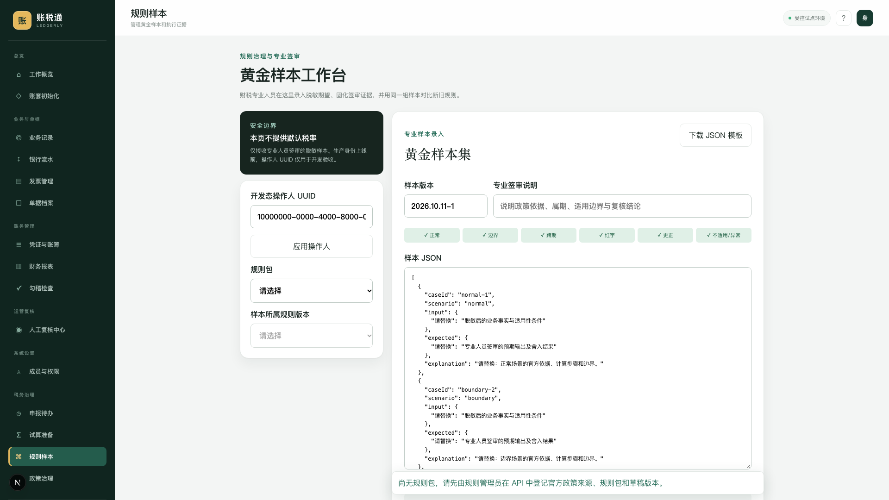

- **页面定位**：财税专业人员和规则研发人员用于验证税务规则的专业质量工作台。
- **主要功能**：选择规则包和已经财税复核的版本，下载 JSON 模板，录入脱敏输入与期望结果，由专业人员不可变签署样本集。
- **测试与证据**：运行全量黄金样本，核对哈希、样本数和场景覆盖，由财税复核人签署测试证据。
- **影子对比**：使用同一组输入对比基线规则与候选规则，固化一致、变化和失败差异，不用生产用户当测试样本。
- **作用价值**：将专业口径变成可重复执行的回归证据，防止政策/程序变更在不知情的情况下改变税额结果。

### 21. 政策与规则治理

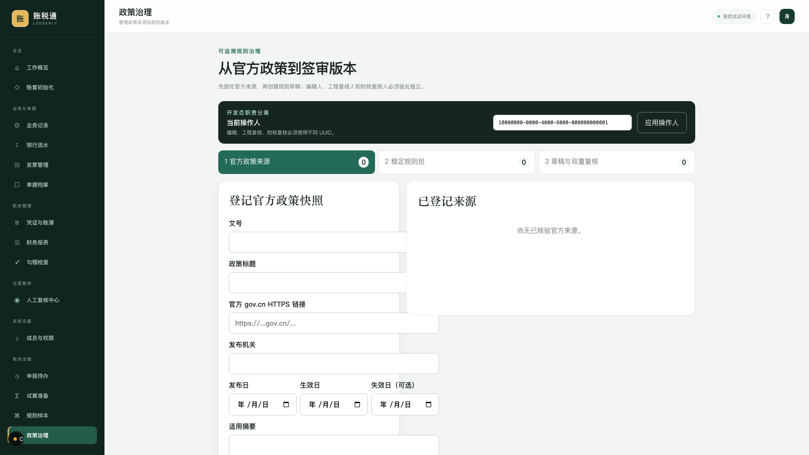

- **页面定位**：从官方政策来源到签审、测试、批准、激活和撤回的完整规则生命周期。
- **政策来源**：登记文号、标题、官方 `gov.cn` HTTPS 链接、发布机关、日期、适用摘要和正文快照哈希。
- **规则版本**：建立稳定规则包和不可执行草稿，明确版本、生效期、依据、适用性、实现键、参数和失败/转人工边界。
- **职责分离**：编辑人、工程复核人、财税复核人、测试签署人和独立批准人按规则互斥，不允许一人完成全部链路。
- **发布控制与价值**：通过黄金样本后才可独立批准、安排未来激活、到期激活或紧急撤回；价值是让每一个税务数字能回答「根据哪条政策、哪个版本、谁复核」。

---

## 8. 成员、邀请与平台权限

### 22. 成员与权限

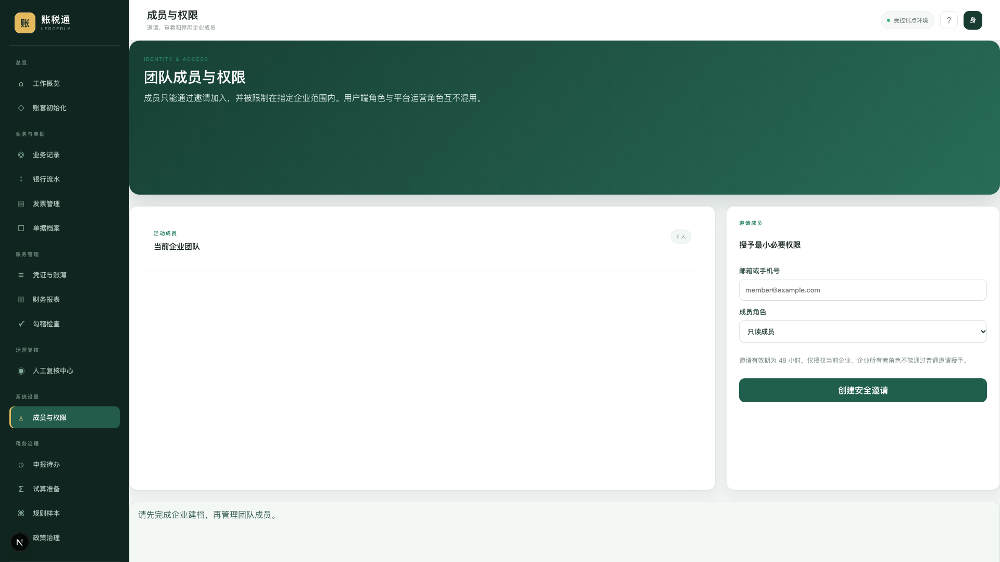

- **页面定位**：企业级成员管理页，管理「谁能访问当前企业、具有什么企业角色」。
- **主要功能**：查看活动/已停用成员、角色和企业范围；通过邮箱或手机号创建 48 小时安全邀请；分配只读成员、记账人员或租户管理员。
- **停用规则**：停用后旧会话不再获得企业访问权；不能停用自己或最后一位企业所有者。
- **权限边界**：企业所有者不能通过普通邀请授予；企业成员角色与平台运营角色互不混用。
- **作用价值**：以「最小必要权限 + 指定企业范围」替代共用账号，减少财务数据越权访问风险。

### 23. 接受企业邀请

- **页面定位**：受邀用户从安全链接加入指定企业的入口。
- **主要功能**：读取一次性邀请令牌，确认当前登录身份，接受邀请并建立租户/企业成员关系。
- **安全规则**：缺少令牌、令牌已过期、已使用或身份不匹配时拒绝加入。
- **主要用户**：被企业所有者/管理员邀请的记账人员、协作人员或只读成员。
- **作用价值**：避免开放搜索企业或自由加入，使每一次成员关系建立都有邀请发起人、范围、时效和审计记录。

### 24. 平台运营角色治理

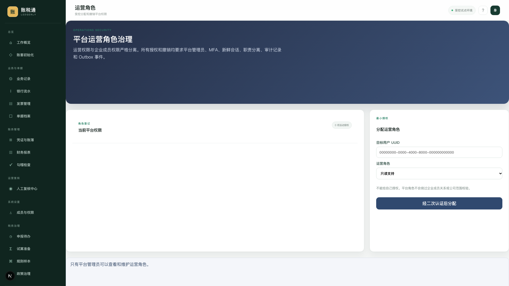

- **页面定位**：平台级高权限角色的授予与撤销页，不面向普通企业用户。
- **角色范围**：只读支持、会计复核、税务复核、规则编辑、规则审批、安全审计和平台管理员。
- **主要功能**：查看当前平台授权，向指定用户 UUID 分配最小角色，撤销已有角色。
- **安全控制**：要求平台管理员身份、MFA、新鲜会话、职责分离、完整审计与 Outbox 事件；不能给自己授权。
- **作用价值**：将平台运营权与企业成员权分开，避免「有运营角色就可读任意企业」的横向越权。

---

## 9. 角色与页面关系

| 用户类型 | 主要使用页面 | 核心目标 |
|---|---|---|
| 潜在客户 | 宣传官网 | 理解产品定位、边界与价值，再决定是否进入平台 |
| 企业所有者/管理员 | 注册、建档、筛查、初始化、成员权限 | 建立可用账套并管理企业协作范围 |
| 企业记账人员 | 业务记录、流水、发票、单据、凭证、报表、勾稽 | 把原始业务变成可核对的账务记录 |
| 企业负责人 | 报表、勾稽、申报待办 | 理解结果、确认关键数字并在官方渠道自主完成操作 |
| 专业财税/会计复核人 | 人工复核中心、黄金样本 | 处理例外，固化专业结论和测试证据 |
| 规则研发/审批人 | 政策治理、黄金样本 | 把官方政策变成可追溯、可测试、可发布的规则版本 |
| 平台管理/安全审计人 | 运营角色治理 | 受控分配高权限并审计变更 |

## 10. 产品级总体价值

1. **对老板更易理解**：用任务、证据和风险提示组织工作，不要求用户先学会复式记账和税务术语。
2. **对专业人员更可复核**：原始证据、业务事实、凭证、报表、试算和申报包之间有明确引用。
3. **对政策变化更可管理**：规则依据、适用性、实现、样本、签审和生效时间全部版本化。
4. **对错误更可追责**：不用删除或静默覆盖消除错误，而是用冲销、更正、新版本、复核决定和审计记录处理。
5. **对自动化更克制**：没有充分事实、规则或专业证据时显式阻断，高风险问题转人工，不为了界面「有结果」而生成伪精确数字。

## 11. 截图状态说明

- 截图使用本地内存演示模式，不包含生产用户或真实财务数据。
- 需要建档、前置业务数据或特定角色的页面，截图可能呈现未建档、空数据、阻断或权限受限状态。这是当前测试上下文的真实界面，不代表页面功能只有空状态。
- 申报页当前包含研发验收用测试日历和无真实税额引用；正式税务资料尚需后续按产品规划补充并经专业复核。
- 本文档说明的是产品功能与系统边界，不构成针对任何具体纳税人的财税专业意见。
